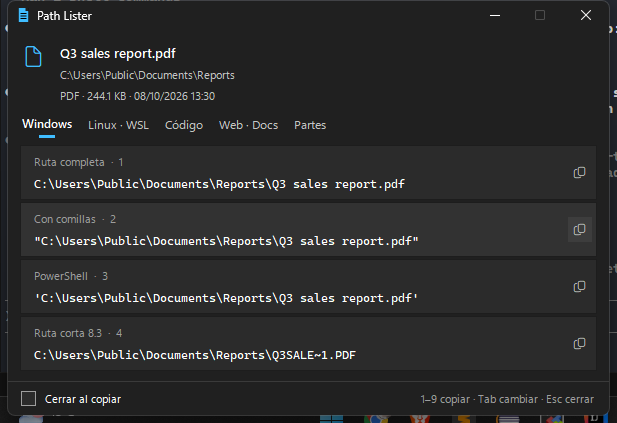
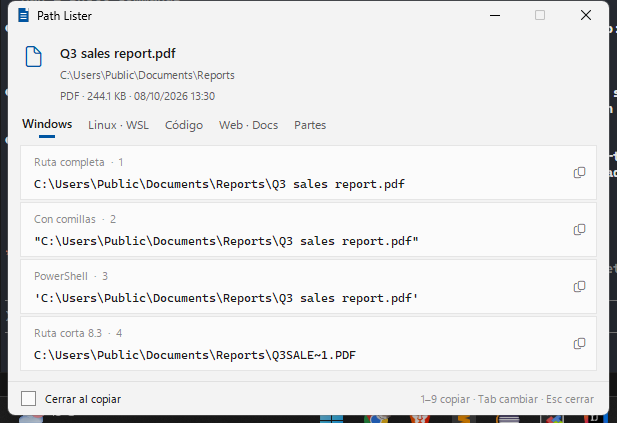
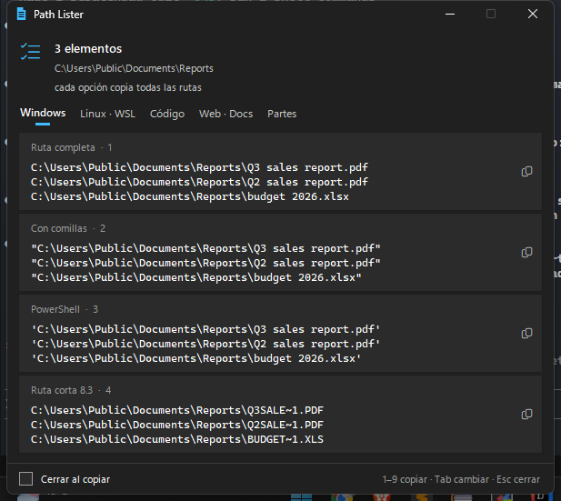

# Path Lister

**Right-click any file or folder in Windows and copy its path in the exact format you need.**

Windows "Properties" shows the folder a file lives in, but not the full path *with* the file name.
And once you have it, you still need to rewrite it for WSL, Git Bash, Python, PowerShell, a Markdown
link… Path Lister gives you every format in one small window that follows your Windows theme.



- **One click to copy** — click a row (or press `1`–`9`) and it's on your clipboard.
- **20+ formats** — Windows, WSL / Git Bash / Cygwin, Python, JSON, C#, PowerShell, `file://`, Markdown, HTML…
- **Network drives** — turns `Z:\Reports\file.pdf` into `\\fileserver\shared\Reports\file.pdf`, so colleagues can open it.
- **Multiple files** — select several files, get one window; each option copies all paths, one per line.
- **Looks native** — follows Windows light/dark mode and your accent color, uses Segoe UI and Fluent icons.
- **No dependencies, no internet** — pure Python standard library (`tkinter`, `ctypes`, `winreg`).

| Light mode | Multiple files |
|---|---|
|  |  |

> The interface is currently in Spanish. English (and other languages) are very welcome — see [Contributing](#contributing).

---

## Installation

**Requirements:** Windows 10/11 and Python 3.8+ from [python.org](https://www.python.org/downloads/)
(the official installer includes `tkinter`).

```powershell
git clone https://github.com/urtaav/path-lister.git
cd path_lister
python install_context_menu.py
```

That's it. No admin rights needed: the installer only writes to your user's registry (`HKEY_CURRENT_USER`).

To remove it:

```powershell
python install_context_menu.py --uninstall
```

> **Moved the folder or changed your Python install?** Run `python install_context_menu.py` again —
> the registry stores absolute paths.

## Usage

1. Right-click a file, a folder, or the empty space inside a folder.
2. On Windows 11 choose **Show more options** (or hold `Shift` while right-clicking).
3. Click **Ver rutas (Path Lister)**.
4. Click the row you want. Done — it's on your clipboard.

### Keyboard shortcuts

| Key | Action |
|---|---|
| `1` – `9` | Copy that row |
| `Enter` | Copy the first row of the current tab |
| `Tab` / `Shift+Tab`, `←` / `→` | Switch tab |
| `Esc` | Close |

Tick **Cerrar al copiar** (*close after copying*) at the bottom to close the window as soon as you copy.
The setting and the last tab you used are remembered.

### Run it without the context menu

```powershell
python path_gui.py "C:\Users\Ana\Documents\Q3 report.pdf"
python path_gui.py file1.pdf file2.pdf file3.xlsx
```

## Formats

Example for `C:\Users\Ana\Documents\Q3 report.pdf`:

### Windows

| Format | Result |
|---|---|
| Full path | `C:\Users\Ana\Documents\Q3 report.pdf` |
| Quoted | `"C:\Users\Ana\Documents\Q3 report.pdf"` |
| Network path (UNC)¹ | `\\fileserver\shared\Reports\Q3 report.pdf` |
| PowerShell | `'C:\Users\Ana\Documents\Q3 report.pdf'` |
| Short 8.3 path² | `C:\Users\Ana\DOCUME~1\Q3REPO~1.PDF` |

¹ Only shown when the file is on a mapped network drive (e.g. `Z:`).
² Only shown when it differs from the full path. Handy for old tools that choke on spaces.

### Linux · WSL

| Format | Result |
|---|---|
| WSL | `/mnt/c/Users/Ana/Documents/Q3 report.pdf` |
| WSL escaped for bash³ | `'/mnt/c/Users/Ana/Documents/Q3 report.pdf'` |
| Git Bash / MSYS2 | `/c/Users/Ana/Documents/Q3 report.pdf` |
| Cygwin | `/cygdrive/c/Users/Ana/Documents/Q3 report.pdf` |

³ Only shown when the path has spaces or other characters the shell would break on.

### Code

| Format | Result |
|---|---|
| Python raw string | `r"C:\Users\Ana\Documents\Q3 report.pdf"` |
| Python / JSON / JS | `"C:\\Users\\Ana\\Documents\\Q3 report.pdf"` |
| pathlib | `Path(r"C:\Users\Ana\Documents\Q3 report.pdf")` |
| Forward slashes | `C:/Users/Ana/Documents/Q3 report.pdf` |
| C# verbatim | `@"C:\Users\Ana\Documents\Q3 report.pdf"` |

### Web · Docs

| Format | Result |
|---|---|
| `file://` URL | `file:///C:/Users/Ana/Documents/Q3%20report.pdf` |
| Markdown | `[Q3 report.pdf](file:///C:/Users/Ana/Documents/Q3%20report.pdf)` |
| HTML | `<a href="file:///C:/Users/Ana/Documents/Q3%20report.pdf">Q3 report.pdf</a>` |

### Parts

| Format | Result |
|---|---|
| Name | `Q3 report.pdf` |
| Name without extension | `Q3 report` |
| Extension | `.pdf` |
| Parent folder | `C:\Users\Ana\Documents` |
| Relative to user | `%USERPROFILE%\Documents\Q3 report.pdf` |

On Linux and macOS the first tab shows the native path, the shell-escaped path and the quoted path instead.

## Command line: list a whole folder

`path_lister.py` prints the formats for every item in a folder — useful for scripts or for copying many paths at once.

```powershell
# Every format for every item in the current folder
python path_lister.py

# Only PDFs, recursively, one forward-slash path per line
python path_lister.py "C:\Users\Ana\Documents" -r -p "*.pdf" -m forward_slash

# Only folders, as WSL paths
python path_lister.py D:\projects -d -m wsl

# Everything as CSV (; separated), ready for Excel
python path_lister.py . -f -m csv > paths.csv
```

| Option | Meaning |
|---|---|
| `-r`, `--recursive` | Include subfolders |
| `-d`, `--dirs-only` | Folders only |
| `-f`, `--files-only` | Files only |
| `-p`, `--pattern` | Glob pattern, e.g. `"*.pdf"` |
| `-m`, `--mode` | `table` (default), `native`, `python_str`, `python_raw`, `forward_slash`, `file_url`, `wsl`, `csv` |

## Themes

Path Lister reads your Windows settings (*Settings → Personalization → Colors*): light/dark app mode
and your accent color. To force a theme, set an environment variable:

```powershell
$env:PATHLISTER_THEME = "light"   # or "dark"
python path_gui.py somefile.txt
```

## Privacy

Path Lister does not collect, send, or log anything. Specifically:

- **No internet access.** The only network call is a socket on `127.0.0.1` (port `47653`), used for a
  fraction of a second to merge several selected files into one window (Explorer launches one process
  per file). Nothing leaves your machine.
- **Files it writes:** `%APPDATA%\PathLister\config.json` — two settings: last tab and "close after copying".
- **Registry keys it writes** (only when you run the installer, removed by `--uninstall`):
  - `HKCU\Software\Classes\*\shell\PathLister`
  - `HKCU\Software\Classes\Directory\shell\PathLister`
  - `HKCU\Software\Classes\Directory\Background\shell\PathLister`
- **Registry keys it reads:** your light/dark mode and accent color, to match Windows.

The whole thing is under 1,000 lines of readable Python. Please read it.

## How it works

```
path_lister/
├── path_gui.py               # The window (tkinter), clipboard, theme, multi-select merging
├── variantes.py              # Builds every path format, grouped in tabs — start here to add a format
├── path_lister.py            # Command-line tool to list a folder
├── install_context_menu.py   # Adds/removes the right-click entry
└── docs/                     # Screenshots
```

- **Context menu:** a registry verb runs `pythonw.exe path_gui.py "%1"` (`pythonw` = no console window).
- **Multiple files:** the first process listens on `127.0.0.1` for ~0.35 s; the others send it their
  path and exit, so you get a single window.
- **Clipboard:** written through the Win32 API, so the text stays on the clipboard after the window closes.
- **Native look:** colors match Windows 11 Fluent; the accent comes from
  `HKCU\...\Explorer\Accent\AccentPalette`, the dark title bar from `DwmSetWindowAttribute`.

## Built-in alternative

Windows already has **Copy as path**: select a file and press `Ctrl+Shift+C`
(or `Shift` + right-click → *Copy as path*). It gives you the quoted full path.
Path Lister is for every other format.

## Contributing

Issues and pull requests are welcome. Some ideas:

- [ ] **English UI / translations** (the interface and code comments are in Spanish)
- [ ] Show the option in the Windows 11 main context menu, not only in "Show more options" (needs an MSIX package + `IExplorerCommand`)
- [ ] Global hotkey (e.g. `Win+Shift+C`) for the file selected in Explorer
- [ ] Reverse conversion: paste a WSL / Git Bash path and get the Windows one
- [ ] macOS Quick Action and Linux (Nautilus / Dolphin) context menu installers
- [ ] Relative path between two selected files
- [ ] Standalone `.exe` (PyInstaller) so Python isn't required

**Adding a new format** usually means one line in `variantes.py` → `secciones()`:

```python
("My format", some_function(s)),   # return None to hide it when it doesn't apply
```

Before opening a PR, check that it works with a file, a folder, a path with spaces,
a drive root (`C:\`) and several selected files.

## License

[MIT](LICENSE)
